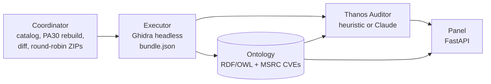

<div align="center">

# Thanos

**Patch Tuesday triage for Windows Server 2022.**
Diff the binaries a cumulative update changes, filter the noise, match the month's real CVEs,
and let **Thanos Auditor** rank what deserves a human review first.

[](https://github.com/oliverjueguen/thanosauditor/actions/workflows/ci.yml)


</div>

---

## Quick start (2 minutes, no Windows or Ghidra needed)

```bash
git clone https://github.com/oliverjueguen/thanosauditor.git && cd thanosauditor
python3 -m venv .venv && source .venv/bin/activate
pip install -r requirements.txt -c constraints.txt
python -m thanos.ontology.cli ingest "fixtures/bundles/*.bundle.json" --fresh
python -m thanos.ontology.cli ingest-cvrf
python -m thanos.auditor.cli analyze "fixtures/bundles/*.bundle.json" -o output/report.json
python -m thanos.panel.app          # open http://127.0.0.1:8000
```

What you get, from the team's **real** April 2026 data (KB5078766 → KB5082142):

| Binary | Priority | Why |
|---|---|---|
| `upnphost.dll` | **P1** | 24 new delay-loaded network imports (WinHTTP, `GetAddrInfoW`); matches 8 real "Windows UPnP Device Host" CVEs of the same month |
| `windows.storage.applicationdata.dll` | **P1** | 32 delay-loaded state APIs removed |
| `fvecerts.dll` | **P1** | +22 imports and new C runtime helpers: flagged as a likely toolchain change |
| 260 function names | filtered | Ghidra auto-generated names (`Unwind@…`, `Catch@…`) that only moved address |

---

## What it does

1. **Coordinator** resolves the KB in the Microsoft Update Catalog, rebuilds the DLLs from the
   update's PA30 deltas (`msdelta.dll`), diffs the manifests and splits the work round-robin into
   one ZIP per teammate.
2. **Executor** runs Ghidra headless on every changed before/after pair and writes a
   `bundle.json` with counts and full function/export name lists.
3. **Ontology** stores bundles and the month's official CVEs (MSRC CVRF) as an RDF/OWL graph in a
   ~170 KB Turtle file, queried with SPARQL.
4. **Thanos Auditor** (the brain) ranks every changed binary: a deterministic heuristic offline, or
   Claude through the Claude Agent SDK with your own Claude subscription.
5. **Panel** shows each cycle with score, auditor verdict and CVE candidates, so every number says
   where it came from.



---

## Versions

| Component | Version | Notes |
|---|---|---|
| Thanos | **1.0.0** | Git tag `v1.0-practica3` |
| Python | 3.10, 3.11, 3.12, 3.13, 3.14 | CI: 3.10 and 3.12 on Linux, 3.12 on Windows |
| FastAPI / Starlette / Uvicorn | 0.143.0 / 1.7.0 (py3.10) or 1.8.0 / 0.54.0 | Panel |
| rdflib | 7.6.0 | Ontology and SPARQL |
| claude-agent-sdk | 0.2.165 | Thanos Auditor with Claude (bundles the Claude CLI) |
| Ghidra / JDK | 11.0.3 / 17 | Executor only; tested on real Windows DLLs |
| pytest / ruff / pip-audit | 9.1.1 / 0.17.0 / 2.10.1 | Quality gates |

Exact pins for every dependency live in [`constraints.txt`](constraints.txt) (generated with `uv`
for Python 3.10 to 3.14).

---

## Install

**Prerequisites:** Python 3.10+ and `git`. On Debian/Ubuntu also `python3-venv`.
Optional: Docker, a Claude account (for the Claude auditor), Ghidra 11.x with a JDK 17+ (only to
run the executor on real binaries).

<details open>
<summary><b>Linux / macOS</b></summary>

```bash
git clone https://github.com/oliverjueguen/thanosauditor.git && cd thanosauditor
python3 -m venv .venv
source .venv/bin/activate
pip install -r requirements.txt -c constraints.txt
cp .env.example .env            # optional: every CLI and the panel load it
```
</details>

<details>
<summary><b>Windows (PowerShell)</b></summary>

```powershell
git clone https://github.com/oliverjueguen/thanosauditor.git; cd thanosauditor
py -3 -m venv .venv
Set-ExecutionPolicy -Scope Process Bypass     # lets this session activate the venv
.\.venv\Scripts\Activate.ps1
pip install -r requirements.txt -c constraints.txt
copy .env.example .env
```
</details>

<details>
<summary><b>Docker</b></summary>

```bash
docker build -t thanos .
docker run --rm -p 127.0.0.1:8000:8000 thanos      # http://127.0.0.1:8000
# or: docker compose up --build
```

Runs the panel as a non-root user, seeded with the real FULL bundle and a heuristic report (upload the second real bundle from `fixtures/bundles/`).
</details>

---

## Thanos Auditor with Claude

```bash
pip install -e ".[auditor]" -c constraints.txt     # Claude Agent SDK, ships the Claude CLI
python -m thanos.auditor.cli login                 # sign in with your Claude account (once)
python -m thanos.auditor.cli status                # check the session
python -m thanos.auditor.cli analyze "fixtures/bundles/*.bundle.json" --backend claude -o output/report.json
```

- Uses **each user's own Claude session**; the product never offers Claude login to third parties.
  Headless machines: `claude setup-token` and `CLAUDE_CODE_OAUTH_TOKEN`.
- If `ANTHROPIC_API_KEY` is set it wins over the subscription and bills per token; `status` warns you.
- About 1 minute per cycle. When Claude is unavailable the report falls back to the heuristic and
  says so (`--no-fallback` exits with code 3 instead).
- The model runs **with no tools at all** and names extracted from binaries are sent as untrusted
  data ([`docs/03_security.md`](docs/03_security.md)).

---

## Coordinator and executor

```bash
python -m thanos.coordinator resolve KB5082142                     # GUID and MSU URL (network)
python -m thanos.coordinator manifest fixtures/bundles/2026-04-patch-tuesday-full.bundle.json
python -m thanos.coordinator diff staging/manifests/before.json staging/manifests/after.json
python -m thanos.coordinator split staging/changed_manifest.json --people ana luis marta pablo
python -m thanos.coordinator package --from-bundle fixtures/bundles/2026-04-patch-tuesday-full.bundle.json
```

Each `staging/zips/thanos-<person>.zip` is a self-contained executor. Its manual is
[`executor/README.md`](executor/README.md): run `bootstrap.ps1`, set `ghidra_support_dir`, run
`run_diff.py`. Windows-only phases and manual procedures:
[`docs/02_coordinator_executor.md`](docs/02_coordinator_executor.md).

---

## Configuration

Copy `.env.example` to `.env`. Every variable is optional.

| Variable | Default | Purpose |
|---|---|---|
| `THANOS_AUDITOR_MODEL` | `claude-opus-5-5` | Model used by the Claude backend |
| `THANOS_PANEL_HOST` / `THANOS_PANEL_PORT` | `127.0.0.1` / `8000` | Panel address |
| `THANOS_PANEL_TOKEN` | empty | When set, uploads require this token |
| `THANOS_PANEL_MAX_UPLOAD_MB` | `5` | Max size per uploaded file |
| `THANOS_PANEL_SEED` | `1` | Seed the empty panel with the real FULL bundle |
| `THANOS_PANEL_REPORT` | `output/report.json` | Auditor report shown in the panel |
| `THANOS_ONTOLOGY_CATALOG` | `data/ontology/catalog.ttl` | Ontology catalog |
| `THANOS_MSRC_CVES` | `fixtures/msrc/2026-Apr.ws2022.json` | Offline MSRC extract (fallback) |
| `THANOS_LOG_LEVEL` | `WARNING` (CLIs), `INFO` (panel) | JSON-lines logs on stderr |

**Test access:** the panel has no user accounts by design and listens on loopback only. To start
from scratch delete `data/panel/` or run with `THANOS_PANEL_SEED=0`. The Claude auditor uses the
account of whoever runs it; no credentials ship with the repo.

---

## Security at a glance

| Control | Where | Proven by |
|---|---|---|
| Strict schema and type validation of every bundle and report | `thanos/core/bundles.py`, `thanos/auditor/report.py` | `tests/test_security.py` (15 malformed inputs) |
| Upload limits, same-origin check (CSRF), Host allow-list, optional token | `thanos/panel/app.py` | `test_cross_origin_post_is_rejected`, `test_upload_token_required_when_configured` |
| CSP, `X-Frame-Options`, `nosniff`, escaped HTML, no tracebacks | `thanos/panel/` | `test_xss_is_escaped`, `test_security_headers_present` |
| LLM with zero tools, untrusted data fenced, strict answer validation | `thanos/auditor/backends.py` | `test_claude_runs_without_any_tool` |
| Local paths stripped from published bundles | `thanos/core/sanitize.py` | `test_real_fixtures_have_no_local_paths` |

`pip-audit`, `bandit` and `ruff` report nothing. Full STRIDE model: [`docs/03_security.md`](docs/03_security.md).

---

## Tests and quality

```bash
pip install -e ".[dev,auditor]" -c constraints.txt
pytest -q                        # 161 tests, offline (with only ".[dev]" the 7 Claude SDK tests are skipped)
ruff check .
pip-audit -r requirements.txt
```

CI ([`.github/workflows/ci.yml`](.github/workflows/ci.yml)) runs the suite on Linux (Python 3.10
and 3.12) and Windows, plus `pip-audit` and `ruff`. Dependabot proposes weekly updates.

---

## Project layout

```
thanos/
├─ coordinator/   Update Catalog, PA30 rebuild, manifest diff, round-robin, ZIPs, CLI
├─ executor/      pairing, Ghidra headless + ExportFacts.java, name diff, bundle
├─ ontology/      RDF/OWL schema, bundle and MSRC CVE ingest, SPARQL, CLI
├─ auditor/       Thanos Auditor: heuristic and Claude backends, report schema
├─ panel/         FastAPI panel
├─ core/          bundle validation, Ghidra noise filter, scoring, aggregation, sanitizing
└─ config.py · log.py · cliutil.py
executor/         what each teammate receives in the ZIP (run_diff.py, bootstrap.ps1, ...)
data/ontology/    catalog.ttl (generated, versioned)
fixtures/         real P1 bundles, MSRC CVEs, Update Catalog HTML, one synthetic bundle
docs/             requirements, phases, security, traceability, tests, video script, evidence
tests/            161 tests
```

**Data used:** `fixtures/bundles/` holds the two **real** bundles the team produced in Practice 1
(85 and 7 binaries; only local paths were sanitized). `fixtures/synthetic/` holds one clearly
labelled synthetic bundle used only by tests. Details: [`fixtures/README.md`](fixtures/README.md).

---

## Documentation

| Doc | Contents |
|---|---|
| [`01_requirements.md`](docs/01_requirements.md) | RF/RNF requirements, initial and final status, justified changes, improvements over P1 |
| [`02_coordinator_executor.md`](docs/02_coordinator_executor.md) | Phases, commands, Windows procedures, environments |
| [`03_security.md`](docs/03_security.md) | STRIDE, credentials, authentication and access, validation, dependencies, personal data |
| [`04_traceability.md`](docs/04_traceability.md) | Requirement → implementation → test → evidence matrix |
| [`05_tests.md`](docs/05_tests.md) | Test plan PR-01 to PR-29, results and tests that failed |
| [`06_video_script.md`](docs/06_video_script.md) | Demo video script, minute by minute |
| [`evidence/`](docs/evidence) | RF-05 on real Windows, RF-13 with real Ghidra |

---

## Status

- [x] Ontology catalog with real MSRC CVEs (RF-01, RNF-03)
- [x] Coordinator: catalog, download, PA30 rebuild, diff, round-robin, ZIPs (RF-02, RF-03, RF-05 to RF-08)
- [ ] Baseline from ISO/WIM (RF-04): pending, manual procedure documented
- [x] Executor with real Ghidra, full name diff and bundle (RF-09, RF-11 to RF-15)
- [~] `bootstrap.ps1` (RF-10): updated, Windows test pending
- [x] Thanos Auditor, heuristic and Claude (RF-16, RF-17, RNF-09)
- [x] Panel with score, auditor verdict and CVE candidates (RF-18 to RF-20)
- [x] Security, error handling, logging, clean install, CI (RNF-04 to RNF-06, RNF-08)
- [~] RNF-01 (no manual-time baseline) and RNF-07 (coordinator on WS2022 not re-run)

Requirement IDs follow the course numbering: RF = functional, RNF = non-functional.

---

## What changed since Practice 1

| P1 | Now | Why |
|---|---|---|
| Catalog in Neo4j on a Raspberry Pi | RDF/OWL ontology in a 170 KB Turtle file, with official MSRC CVEs | Fits in Git, installs anywhere, no server |
| Local `llama.cpp` analyst | Thanos Auditor: Claude via the Agent SDK with your subscription, plus an offline heuristic | Reproducible, isolated, better triage |
| Ghidra driven through Claude Code and MCP | `analyzeHeadless` + `ExportFacts.java` | Reproducible and testable |
| Score = functions added + removed | Weighted score with the Ghidra noise filter | 80% of the P1 name diff was noise |

---

## Use of AI tools

| Tool | Use | Scope |
|---|---|---|
| **Claude Code** (Anthropic, Claude Opus models) | Generated most of the code, tests and documentation from the P1 report and the P3 brief, directed by the team; ran a multi-agent audit of the repository and its fixes | The team set the scope and decisions (ontology, Claude subscription, real data), reviewed and ran every part and owns the result; every member can explain any module |
| **Claude** via the Claude Agent SDK | Product component: Thanos Auditor (RF-16) | Runs with no tools, using each user's own Claude account |

---

## Context and license

Practice 3 of the Master's in Cybersecurity & AI (Evolve Academy): the product evolution of the
team's Practice 1. Thanos is a **defensive** tool: it only analyzes public Microsoft updates on
the team's own machines, and only sends read-only requests to Microsoft's public APIs.

MIT licensed ([`LICENSE`](LICENSE)). Ghidra (Apache 2.0) is not redistributed.

**Team:** Oliver Jueguen Vazquez · Oana Maria Arsinte · Manuel Cordero Romero · Antonio Vergara
